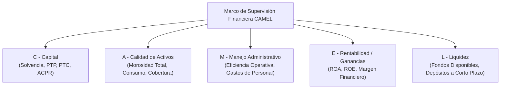

# Sistema de Indicadores Financieros SFPS (ESPOCH-DI-060)
### Plataforma Analítica e Interactiva de Inteligencia Financiera y Supervisión

Plataforma analítica integral de indicadores financieros para el Sector Financiero Popular y Solidario (**SFPS**) del Ecuador (Superintendencia de Economía Popular y Solidaria - **SEPS**), construida bajo metodología **Spec-Driven Development (SDD)** en el marco del proyecto de investigación **ESPOCH-DI-060** en colaboración con **Uprocach**.

Procesa balances mensuales de la estructura oficial **B11** (2018–2025+) y calcula de forma vectorizada el catálogo normativo de las **Fichas Metodológicas Oficiales V3.0** bajo el marco internacional **CAMEL**.

---

## 📚 Documentación del Sistema

Para consultar las guías detalladas según su perfil:

| Documento | Audiencia | Descripción |
| :--- | :--- | :--- |
| 📖 [**Manual de Usuario**](docs/MANUAL_DE_USUARIO.md) | Analistas, Directivos, Docentes, Estudiantes | Guía interactiva de uso, navegación CAMEL, benchmarking, ranking y exportaciones. |
| 🛠️ [**Manual Técnico de Arquitectura**](docs/MANUAL_TECNICO.md) | Ingenieros, Arquitectos, Desarrolladores | Especificaciones del contrato OpenAPI, motor DuckDB, seguridad, APIs y persistencia. |
| ☁️ [**Guía de Despliegue Zero-Cost**](docs/deployment/vercel-supabase.md) | Administradores de Infraestructura | Pasos para el despliegue gratuito perpetuo en Vercel + Supabase + GitHub Actions. |
| 📜 [**Glosario de Dominio**](GLOSSARY.md) | General | Definiciones oficiales de cuentas CUC, polaridades, roles RBAC y términos de la SEPS. |

---

## 🏗️ Stack Tecnológico

- **Contrato Vinculante (SDD):** OpenAPI 3.1.0 ([`contracts/openapi.yaml`](contracts/openapi.yaml)) con linter estricto Spectral ([`contracts/.spectral.yaml`](contracts/.spectral.yaml)) y tipado estricto end-to-end.
- **Motor Analítico Vectorizado:** Python + DuckDB (procesamiento columnar SIMD sobre millones de registros contables en segundos) con almacenamiento en cubos Parquet ([`data/processed/mart/`](data/processed/mart/)).
- **Backend de Servicios:** FastAPI (Python 3.12) con respuestas de error normalizadas RFC 9457 (`application/problem+json`).
- **Persistencia Dual y Gobernanza:** Capa agnóstica de persistencia que conmuta automáticamente entre PostgreSQL en la nube ([Supabase](https://supabase.com/)) y SQLite local con modo Write-Ahead Logging (`WAL`).
- **Seguridad y Control de Acceso (RBAC):** Autenticación mediante tokens JWT firmados criptográficamente y encapsulados en cookies seguras `HttpOnly`, protección CSRF por validación de origen y forzado de cambio de clave en primer acceso.
- **Frontend SPA:** React 18 + Vite 6 + TypeScript 5 + Tailwind CSS + **shadcn/ui** con paleta financiera institucional (esmeralda, bosque, ámbar, tonos pastel para Recharts).
- **Tipado End-to-End:** Tipos de TypeScript generados automáticamente desde el contrato OpenAPI ([`frontend/src/types/api.ts`](frontend/src/types/api.ts)).

---

## 📊 Marco Analítico CAMEL Implementado

La plataforma cubre de manera exhaustiva las 5 dimensiones del estándar de supervisión bancaria:



### Indicadores Clave de Muestra

| Indicador | Dimensión | Ficha SEPS | Fórmulas Contables CUC | Sentido Deseable | Unidad |
| :--- | :--- | :--- | :--- | :--- | :--- |
| **Solvencia Patrimonial** | Capital | Ficha 1 | `(c3 + anualizado(c5 - c4)) / act_inmo_net * 100` | Mayor es mejor | `%` |
| **Morosidad de Cartera Total** | Activos | Ficha 5 | `cartera_improductiva / (c14 - c1499) * 100` | Menor es mejor | `%` |
| **Cobertura de Cartera** | Activos | Ficha 18 | `(-c1499) / cartera_improductiva * 100` | Mayor es mejor | `%` |
| **Eficiencia Operativa** | Manejo | Ficha 31 | `(c45 * 12 / mes) / activo_promedio_ytd * 100` | Menor es mejor | `%` |
| **ROA (Rentabilidad Activos)** | Ganancias | Ficha 35 | Ene-Nov: `((c5 - c4) * 12 / mes) / activo_promedio_ytd * 100`<br>Dic: `(c3603 + c3604) / c1 * 100` | Mayor es mejor | `%` |
| **ROE (Rentabilidad Patrimonio)**| Ganancias | Ficha 34 | Ene-Nov: `((c5 - c4) * 12 / mes) / patrimonio_promedio_ytd * 100`<br>Dic: `resultado_cierre / (c3 - resultado_cierre) * 100` | Mayor es mejor | `%` |
| **Liquidez Inmediata** | Liquidez | Ficha 52 | `c11 (Fondos Disponibles) / c21 (Depósitos) * 100` | Mayor es mejor | `%` |
| **Patrimonio Técnico Primario** | Capital | Ficha 58 | Magnitud contable neta computable | Mayor es mejor | `$` |
| **Activos Ponderados x Riesgo** | Capital | Ficha 61 | Activos totales ponderados por riesgo normativo | Mayor es mejor | `$` |

> [!IMPORTANT]
> **Metodología de Agregación:** Todas las cifras sectoriales a nivel país o segmento se calculan por **ratio de sumas** ($\frac{\sum \text{numeradores}}{\sum \text{denominadores}}$), replicando fielmente la metodología de agregación del sistema cooperativo ecuatoriano sin distorsión por tamaño de entidad.

---

## 🚀 Comandos de Ejecución y Desarrollo

### 1. Pruebas y Validación Integral (Full-Stack)
Ejecute la suite completa con un solo comando:
```bash
npm run test
```
Este comando ejecuta secuencialmente:
1. `npm run contract:lint`: Validación estricta Spectral del contrato OpenAPI 3.1.0.
2. `npm run etl:test`: Verificación matemática y conciliación de cubos DuckDB.
3. `npm run backend:test`: 76 pruebas de integración del backend FastAPI (Pytest).
4. `npm run frontend:build`: Verificación de tipos TypeScript (`tsc`) y compilación Vite.

### 2. Entorno de Desarrollo Local
```bash
# Iniciar backend FastAPI en http://localhost:8000
npm run backend:dev

# En otra terminal, iniciar frontend React en http://localhost:5173
npm run frontend:dev
```

### 3. Pipeline de Datos y Sincronización SEPS
```bash
# Ejecutar pipeline completo y regenerar cubos en data/processed/mart/
npm run etl:run

# Validar integridad matemática de los cubos Parquet
npm run etl:test

# Ejecutar sincronización automatizada (descarga, validación gatekeeper y swap atómico)
npm run pipeline:sync
```

### 4. Contratos y Tipado
```bash
# Auditar contrato OpenAPI contra Spectral
npm run contract:lint

# Regenerar tipos TypeScript en el frontend desde contracts/openapi.yaml
npm run frontend:codegen

# Iniciar servidor mock Prism en http://localhost:4010
npm run contract:mock
```

---

## 🛡️ Niveles de Acceso y Credenciales Maestras

- **Público General:** Consulta libre sin autenticación de los 5 indicadores fundamentales del SFPS a nivel macro (País y Segmento).
- **Acceso Acreditado Institucional:** Para directivos, auditores y analistas autorizados.
  - **Credenciales Maestras Iniciales (Admin):**
    - Usuario: `dennys.rojas` (o correo `@espoch.edu.ec`)
    - Contraseña Inicial: `dennys.rojas` *(El sistema fuerza el cambio obligatorio a una contraseña personal secreta en el primer ingreso)*.

---

## 🏛️ Créditos Institucionales
- **Institución:** Escuela Superior Politécnica de Chimborazo (ESPOCH).
- **Proyecto de Investigación:** ESPOCH-DI-060.
- **Convenio y Colaboración Técnica:** Uprocach.
