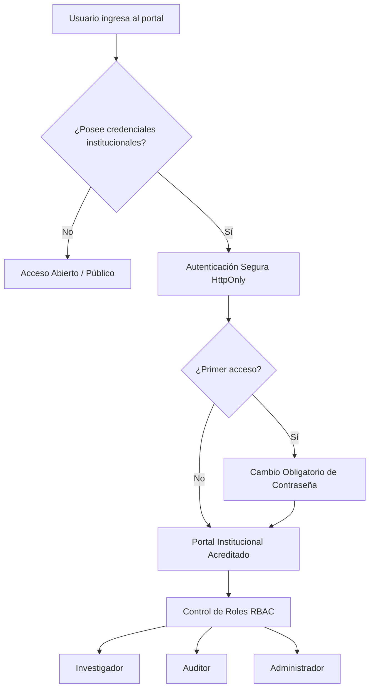

# Manual de Usuario - Plataforma de Indicadores Financieros SFPS (ESPOCH-DI-060)

Plataforma analítica e interactiva para el seguimiento, supervisión y benchmarking de los indicadores financieros del Sector Financiero Popular y Solidario (SFPS) del Ecuador, desarrollada en el marco del proyecto de investigación **ESPOCH-DI-060** en colaboración con **Uprocach**.

---

## 1. Introducción y Propósito

El **Sistema de Indicadores Financieros SFPS** es una herramienta web de inteligencia de negocios y supervisión diseñada para transformar los balances mensuales remitidos a la Superintendencia de Economía Popular y Solidaria (**SEPS**, estructura B11) en información accionable, oportuna y estadísticamente rigurosa.

### Objetivos Clave
- **Monitoreo Continuo:** Seguimiento histórico (2018–2025+) de los indicadores de solvencia, liquidez, calidad de cartera y rentabilidad.
- **Metodología CAMEL:** Evaluación multidimensional bajo el estándar normativo de supervisión financiera internacional adaptado a la regulación ecuatoriana.
- **Benchmarking Objetivo:** Comparación directa entre cooperativas individuales, su respectivo segmento SEPS (Segmento 1, 2, 3, etc.) y la media agregada de todo el país.
- **Gobernanza y Transparencia:** Acceso público a cifras agregadas y acceso acreditado con control de roles (RBAC) y bitácora forense para investigadores y directivos.

---

## 2. Niveles de Acceso y Perfiles de Usuario

La plataforma implementa un modelo de seguridad por capas que balancea la apertura informativa institucional con la protección de microdatos:

### Tabla de Perfiles y Capacidades

| Nivel / Rol | Indicadores Disponibles | Comparativa Entidades | Exportación de Datos | Bitácora y Usuarios |
| :--- | :--- | :--- | :--- | :--- |
| **Acceso Público** | 5 Indicadores Núcleo (Solvencia, Morosidad, Cobertura, ROA, Liquidez) | Macro / Sectorial (País y Segmento) | No habilitada | Inaccesible |
| **Investigador** (`investigador`) | Catálogo Completo (28+ indicadores CAMEL) | Hasta 5 cooperativas simultáneas | Formato CSV con BOM UTF-8 | Inaccesible |
| **Auditor** (`auditor`) | Catálogo Completo (28+ indicadores CAMEL) | Hasta 5 cooperativas simultáneas | CSV y libros Excel ejecutivos | Consulta de Bitácora Forense |
| **Administrador** (`admin`) | Control Total de la Plataforma | Todas las funciones analíticas | CSV y libros Excel ejecutivos | Gestión de Usuarios y Auditoría |

---

## 3. Guía de Navegación del Acceso Público

El acceso público no requiere inicio de sesión ni registro previo. Está disponible directamente al ingresar a la URL de la plataforma.

### 3.1. Barra Superior y Filtros Globales
- **Selector de Período Temporal:** Permite escoger el año y mes de análisis (desde enero de 2018 hasta la fecha de balance más reciente publicada por la SEPS).
- **Selector de Segmento SEPS:** Filtra las agregaciones macroeconómicas entre:
  - *Todos los Segmentos (Consolidado Nacional)*.
  - *Segmento 1 (Grandes Cooperativas > USD 80M)*.
  - *Segmento 1 Mutualista*.
  - *Segmentos 2, 3, 4 y 5*.
- **Selector de Provincia:** Segmenta geográficamente los datos a nivel de las 24 provincias del Ecuador.

### 3.2. Tarjetas de Indicadores Clave (KPIs)
En la vista principal se exhiben los 5 indicadores fundamentales del sistema financiero:
1. **Solvencia Patrimonial (Ficha 1):** Suficiencia patrimonial técnica sobre activos inmovilizados.
2. **Morosidad de Cartera (Ficha 5):** Proporción de la cartera de crédito en mora o improductiva.
3. **Cobertura de Cartera Improductiva (Ficha 18):** Nivel de provisiones acumuladas frente a la cartera vencida.
4. **Rentabilidad sobre Activos - ROA (Ficha 35):** Desempeño y retorno económico generado por la masa de activos.
5. **Liquidez Inmediata (Ficha 52):** Proporción de fondos disponibles inmediatos en caja y bancos frente a captaciones del público.

> [!NOTE]
> Cada tarjeta muestra el valor porcentual del período, la tendencia respecto al mes anterior (indicada en verde si mejora o rojo si empeora de acuerdo a la polaridad deseable) y la comparación contra el promedio nacional.

### 3.3. Análisis de Tendencia Histórica y Distribución
- **Gráfica de Series de Tiempo:** Muestra la evolución mensual histórica del indicador seleccionado, permitiendo comparar la curva de la entidad/segmento frente a la línea base nacional.
- **Gráfica de Distribución por Segmento:** Diagrama de barras comparativo que evidencia la dispersión del ratio entre los distintos estratos de cooperativas.

---

## 4. Acceso Institucional Acreditado

Para analistas financieros, directivos de cooperativas, docentes y supervisores de la ESPOCH y Uprocach, el sistema ofrece el entorno analítico avanzado.

### 4.1. Proceso de Inicio de Sesión
1. En la esquina superior derecha del portal, haga clic en el botón **Acceso Acreditado**.
2. Ingrese su identificador de usuario institucional (ej. `nombre.apellido` o correo `@espoch.edu.ec`) y su contraseña.
3. El sistema valida las credenciales y establece una sesión segura mediante cookies criptográficas `HttpOnly`.

### 4.2. Cambio Obligatorio de Contraseña en Primer Acceso
Por directriz de seguridad de la ESPOCH (ADR-0002):
- A los usuarios de nuevo ingreso se les asigna una contraseña temporal predeterminada.
- Al ingresar por primera vez, el sistema detecta la bandera `must_change_password` y bloquea la navegación desplegando un cuadro de diálogo obligatorio.
- Debe ingresar una nueva clave personal secreta de mínimo 6 caracteres.
- Una vez actualizada, el sistema desbloquea inmediatamente todas las vistas acreditadas.

---

## 5. Módulos Avanzados (Acceso Acreditado)

### 5.1. Dimensiones CAMEL
En el menú lateral izquierdo, la sección **Dimensiones CAMEL** permite auditar las 5 áreas normativas de supervisión:
- **Capital (C):** Solvencia patrimonial, relación de activos ponderados por riesgo, patrimonio técnico primario (PTP) y constituido (PTC).
- **Activos (A):** Morosidad total, morosidad por tipo de crédito (consumo, microcrédito, inmobiliario), tasa de castigos y cobertura de provisiones.
- **Manejo Administrativo (M):** Gastos de operación sobre activo promedio, absorción operativa y eficiencia del personal.
- **Rentabilidad / Ganancias (E):** Rendimiento sobre activos (ROA), rendimiento sobre patrimonio (ROE) y margen de intermediación neto.
- **Liquidez (L):** Fondos disponibles sobre depósitos de corto plazo, relación de intermediación financiera y brecha de liquidez.

### 5.2. Matriz Normativa CAMEL y Semáforo de Riesgo
Ubicada en la vista de **Benchmarking**, esta matriz consolida en una sola tabla la totalidad de fichas normativas con su evaluación semafórica automatizada:
- 🟢 **Verde (Cumple / Favorable):** El ratio satisface el estándar técnico normativo fijado por la SEPS.
- 🟡 **Amarillo (Alerta / En Observación):** El indicador se sitúa dentro del margen de tolerancia o cercano al límite legal.
- 🔴 **Rojo (Crítico / No Cumple):** El indicador se desvía desfavorablemente de la norma o la cooperativa presenta patrimonio técnico deficitario.

#### Columnas de Referencia Dinámica:
- **Línea Base Segmento 1:** Media consolidada calculada por *ratio de sumas* para las cooperativas más grandes del país.
- **Línea Base Nacional:** Promedio ponderado de todo el sector cooperativo ecuatoriano.
- **Unidades Adaptativas:** Las variables monetarias (ej. Patrimonio Técnico en USD) se expresan automáticamente en dólares (`$`), mientras que los índices de cobertura y morosidad se muestran en porcentaje (`%`) o ratio.

### 5.3. Comparador Multi-Entidad (Benchmarking Pro)
Permite someter a contraste directo hasta **5 cooperativas simultáneas**:
1. Utilice el buscador predictivo para ingresar el RUC o Razón Social de las cooperativas que desea analizar.
2. La plataforma generará automáticamente:
   - **Tarjetas de Fichas Críticas:** Diagnóstico rápido de los 6 indicadores más sensibles con la brecha numérica frente al Segmento 1.
   - **Gráfica de Evolución Temporal Comparativa:** Trazado multilínea donde se sobrepone la trayectoria de las cooperativas elegidas frente a la referencia nacional.
   - **Gráfico de Barras de Posicionamiento:** Comparación lado a lado para el mes de corte activo.

### 5.4. Ranking Nacional del SFPS
Permite ordenar a todas las entidades del sistema según su desempeño en cualquier indicador seleccionado:
- Ordenamiento ascendente o descendente según la polaridad deseable (`Mayor es mejor` o `Menor es mejor`).
- Búsqueda por nombre de cooperativa, RUC o provincia.
- Visualización de activos totales, valor exacto del ratio, distintivo semafórico y distancia numérica respecto a la media del país.

### 5.5. Exportación de Datos
Dependiendo de su rol acreditado:
- **Exportación CSV (Investigadores y superiores):** Descarga el conjunto completo de microdatos del corte mensual seleccionado con codificación UTF-8 con BOM (compatible con Microsoft Excel y scripts de R/Python).
- **Exportación Excel Ejecutiva (Auditores y Administradores):** Genera un libro de trabajo `.xlsx` multioja con tablas estilizadas, formato condicional, títulos corporativos de la ESPOCH y metadatos del corte.

---

## 6. Panel de Administración y Seguridad (Rol Administrador)

Los usuarios con rol `admin` tienen a su disposición herramientas de gobernanza institucional:

### 6.1. Padrón de Usuarios Acreditados
- **Creación Individual de Usuario:** Registro de nuevos analistas ingresando nombre, apellido, correo institucional `@espoch.edu.ec` y asignación de rol (`investigador`, `auditor`, `admin`).
- **Importación Masiva (Bulk Import):** Carga simultánea de múltiples cuentas a partir de listas institucionales.
- **Restablecimiento Asistido de Claves:** Ante el olvido de credenciales por parte de un usuario, el administrador puede reiniciar la cuenta a su contraseña predeterminada, activando automáticamente el cambio forzoso de clave en su siguiente ingreso.
- **Activación / Suspensión de Cuentas:** Interruptor de un clic para revocar temporalmente el acceso a la plataforma sin eliminar el historial de auditoría.

### 6.2. Bitácora de Auditoría Forense
Registra de forma inmutable en base de datos cada acción relevante realizada en el sistema:
- Inicio y cierre de sesión.
- Cambios de contraseña y restablecimientos asistidos.
- Consultas analíticas y filtros aplicados.
- Descargas de archivos CSV y reportes Excel (con IP de origen y agente de usuario).
- Modificaciones en el padrón de usuarios.

---

## 7. Preguntas Frecuentes y Soporte

**¿Por qué algunos indicadores se muestran en `$` y otros en `%`?**  
La plataforma clasifica estrictamente la naturaleza de cada ficha de la SEPS. Indicadores como el Patrimonio Técnico Primario (Ficha 58) o los Activos Ponderados por Riesgo (Ficha 61) son magnitudes dinerarias en dólares de los Estados Unidos, mientras que ratios como la Morosidad (Ficha 5) o la Solvencia (Ficha 1) son porcentajes.

**¿Con qué frecuencia se actualizan los datos?**  
La SEPS publica la información contable mensual los días 18 y 25 de cada mes. El sistema cuenta con un pipeline automatizado que detecta y carga los nuevos balances de manera desatendida.

**¿A quién acudir en caso de bloqueo de credenciales?**  
Debe contactar al administrador del proyecto en la ESPOCH / Uprocach para que proceda con el restablecimiento asistido de su cuenta institucional.
