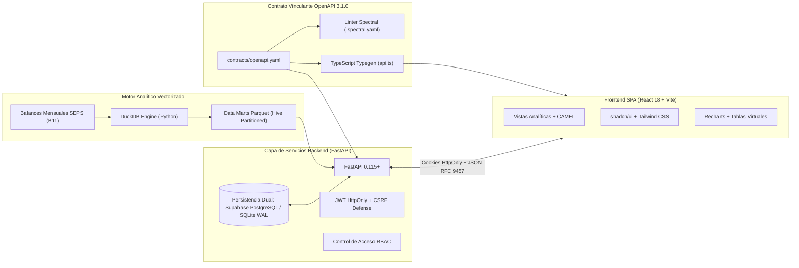
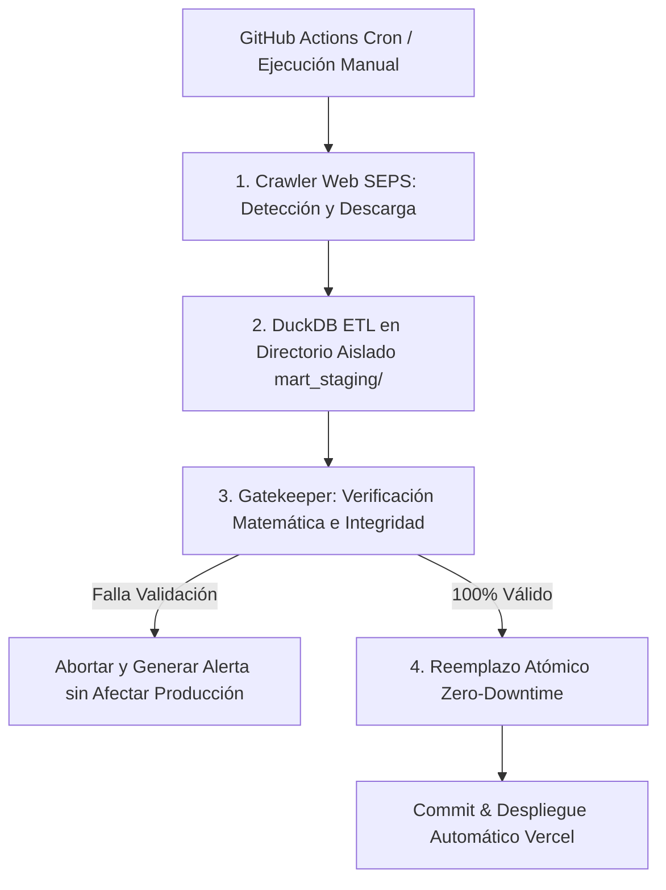

# Manual Técnico de Arquitectura y Desarrollo - Sistema SFPS (ESPOCH-DI-060)

Documentación técnica integral de arquitectura de software, especificaciones de ingeniería, modelo de datos y directrices de despliegue para la plataforma analítica de indicadores financieros del Sector Financiero Popular y Solidario (SFPS) del Ecuador.

---

## 1. Arquitectura General del Sistema

La plataforma adopta la metodología **Spec-Driven Development (SDD)**, donde el contrato formal OpenAPI actúa como la única fuente de verdad (Single Source of Truth) que rige tanto la implementación del backend como la generación de tipos y componentes del frontend.



---

## 2. Contrato OpenAPI 3.1.0 y Estándares de Comunicación

- **Ubicación:** [`contracts/openapi.yaml`](contracts/openapi.yaml)
- **Reglas de Calidad:** [`contracts/.spectral.yaml`](contracts/.spectral.yaml)
- **Protocolo de Errores:** Todos los endpoints responden ante anomalías siguiendo estrictamente el estándar **RFC 9457 (Problem Details for HTTP APIs)** utilizando el tipo de medio `application/problem+json`.
- **Estructura Estándar de Error RFC 9457:**
  ```json
  {
    "type": "about:blank",
    "title": "Violación de seguridad CSRF",
    "status": 403,
    "detail": "Origen no autorizado o cabecera ausente en solicitud autenticada por cookie.",
    "instance": "/api/v1/pro/auth/change-password"
  }
  ```
- **Validación Automática:** Se ejecuta en CI y localmente mediante:
  ```bash
  npm run contract:lint
  ```

---

## 3. Motor Analítico Vectorizado (DuckDB + Parquet)

El núcleo de cálculo analítico opera sobre **DuckDB**, un motor SQL OLAP columnar en memoria optimizado para microprocesadores modernos mediante vectorización SIMD.

### 3.1. Particionado de Datos (Hive Partitioning)
Los cubos de datos multidimensionales residen en [`data/processed/mart/`](data/processed/mart/) bajo particionado de estilo Hive:
```
data/processed/mart/
├── fct_indicators_country_monthly/
│   └── year=YYYY/month=MM/data.parquet
├── fct_indicators_segment_monthly/
│   └── year=YYYY/month=MM/data.parquet
└── fct_indicators_entity_monthly/
    └── year=YYYY/month=MM/data.parquet
```

### 3.2. Principio Metodológico de Agregación: Ratio de Sumas
En cumplimiento con la normativa de la SEPS y las buenas prácticas econométricas del sistema financiero ecuatoriano:
$$\text{Ratio Agregado} = \frac{\sum \text{Numeradores}}{\sum \text{Denominadores}} \times 100$$
Bajo ninguna circunstancia se computan agregados macroeconómicos o sectoriales promediando ratios precalculados ($\frac{\sum \text{Ratios}}{n}$), garantizando que las cooperativas más grandes ponderen adecuadamente en la media del segmento y del país.

### 3.3. Catálogo de Cuentas (CUC) y Fórmulas Contables
El catálogo maestro de indicadores se define formalmente en [`config/indicators_spec.json`](config/indicators_spec.json):
- **Unidades:** Clasificadas formalmente como `percent` (porcentaje), `usd` (magnitud monetaria en dólares) y `ratio` (razón matemática sin escala porcentual).
- **Polaridad de Riesgo:**
  - `higher_is_better`: Rentabilidad (ROA, ROE), Solvencia Patrimonial, Cobertura de Provisiones.
  - `lower_is_better`: Morosidad de Cartera, Gastos de Operación.
  - `neutral`: Intermediación Financiera.

---

## 4. Backend FastAPI y Persistencia Dual

El servicio backend se implementa con **FastAPI** en Python 3.12, exponiendo APIs asíncronas de alto rendimiento y baja latencia.

### 4.1. Servicio de Persistencia Dual (`DualPersistenceService`)
Ubicado en [`backend/app/services/dual_persistence.py`](backend/app/services/dual_persistence.py), desacopla la aplicación del motor de base de datos relacional subyacente:
1. **Entorno de Producción (Supabase):** Si la variable de entorno `DATABASE_URL` está definida, el backend se conecta automáticamente a PostgreSQL mediante un pool de conexiones optimizado para funciones serverless (`Transaction Pooler`).
2. **Entorno Local / Pruebas (SQLite WAL):** En ausencia de `DATABASE_URL`, el sistema conmuta de forma transparente a una base de datos SQLite embebida en [`data/users.db`](data/users.db) con modo Write-Ahead Logging (`PRAGMA journal_mode=WAL`) y cerrojos multihilo `sqlite3.Row`.
3. **Auto-Sembrado Idempotente:** En el ciclo de vida inicial (`lifespan`) de FastAPI, se crean automáticamente las tablas `users` y `audit_logs` y se siembra de forma atómica el usuario administrador maestro sin necesidad de migraciones externas complejas.

### 4.2. Esquema Relacional de Gobernanza
```sql
CREATE TABLE IF NOT EXISTS users (
    id TEXT PRIMARY KEY,
    username TEXT UNIQUE NOT NULL,
    email TEXT UNIQUE NOT NULL,
    first_name TEXT NOT NULL,
    last_name TEXT NOT NULL,
    password_hash TEXT NOT NULL,
    salt TEXT NOT NULL,
    role TEXT NOT NULL DEFAULT 'investigador',
    is_active INTEGER NOT NULL DEFAULT 1,
    must_change_password INTEGER NOT NULL DEFAULT 1,
    created_at TEXT NOT NULL,
    updated_at TEXT NOT NULL,
    last_login_at TEXT
);

CREATE TABLE IF NOT EXISTS audit_logs (
    id TEXT PRIMARY KEY,
    timestamp TEXT NOT NULL,
    user_id TEXT NOT NULL,
    username TEXT NOT NULL,
    action TEXT NOT NULL,
    resource TEXT NOT NULL,
    status TEXT NOT NULL,
    ip_address TEXT,
    user_agent TEXT,
    details TEXT
);
```

---

## 5. Seguridad y Control de Acceso

### 5.1. Criptografía de Credenciales
- Algoritmo: **PBKDF2-HMAC-SHA256** con 100,000 iteraciones y salt criptográfico aleatorio único de 32 bytes por usuario generado mediante `secrets.token_hex(16)`.
- Comparación en tiempo constante (`hmac.compare_digest`) para prevenir ataques de temporización (timing attacks).

### 5.2. Sesión por Cookies HttpOnly
- En lugar de almacenar tokens JWT en `localStorage` o `sessionStorage` (vulnerables a ataques Cross-Site Scripting / XSS), el token se inyecta en una cookie con los atributos:
  - `HttpOnly=True` (inaccesible desde JavaScript en el navegador).
  - `SameSite=Lax` (protección estándar contra navegación forzada externa).
  - `Secure=True` en entornos de producción (HTTPS obligatorio).
  - `Path=/api`.

### 5.3. Protección CSRF
Las peticiones que alteran estado (`POST`, `PUT`, `DELETE`, `PATCH`) dirigidas a rutas autenticadas son evaluadas por un middleware de seguridad que valida la cabecera `Origin` o `Referer` contra la lista de orígenes permitidos de la institución o el host de la petición.

### 5.4. Jerarquía de Roles (RBAC)
- **`investigador`:** Acceso a series completas, matriz CAMEL y exportación CSV.
- **`auditor`:** Lo anterior más exportación de reportes ejecutivos en formato Excel multioja y consulta de la bitácora de auditoría forense.
- **`admin`:** Control total, gestión del padrón de usuarios, restablecimientos de clave y monitoreo de la bitácora.

---

## 6. Pipeline de Actualización Automatizada Cero-Downtime

La sincronización de datos con los balances publicados mensualmente por la SEPS se ejecuta a través de un pipeline automatizado de 4 fases:



### Protocolo de Verificación Gatekeeper
Antes de conmutar los cubos de datos a producción, el validador estricto inspecciona:
1. Completitud de los períodos esperados y presencia de archivos Parquet.
2. Conciliación matemática de ratios: verifica que para el 100% de los registros se cumpla algebraicamente $| \text{valor} - \frac{\text{numerador}}{\text{denominador}} \times 100 | \le 0.001$.
3. Integridad referencial de códigos RUC y nombres de cooperativas en el padrón del SFPS.

---

## 7. Frontend React 18 & Arquitectura de Componentes

- **Tecnologías:** React 18, Vite 6, TypeScript 5, Tailwind CSS 3, Radix UI / shadcn/ui.
- **Visualización:** Recharts con paleta institucional adaptativa:
  - `Esmeralda (#047857)` / `Bosque (#064E3B)`: Identidad corporativa de la ESPOCH y salud financiera positiva.
  - `Ámbar (#D97706)`: Alerta preventiva y estado de observación.
  - `Rosa/Rojo (#E11D48)`: Estado crítico normativo.
- **Formateo Numérico Unificado (`lib/utils.ts`):**
  - Magnitudes monetarias en dólares formateadas con abreviaciones financieras legibles (`$2.63B`, `$407.25M`, `$12.5k`).
  - Índices porcentuales con 2 decimales y símbolo `%`.
  - Ratios puros con 2 decimales numéricos sin unidad monetaria ni porcentual.

---

## 8. Guía de Pruebas y Aseguramiento de Calidad

El proyecto dispone de un pipeline de pruebas unificado ejecutable mediante:
```bash
npm run test
```

Este comando ejecuta de forma secuencial y estricta:
1. **Auditoría de Contrato Spectral:**
   ```bash
   npm run contract:lint
   ```
   Valida que `contracts/openapi.yaml` cumpla el 100% de reglas OpenAPI 3.1.0 sin advertencias.
2. **Validación Matemática de Data Marts:**
   ```bash
   npm run etl:test
   ```
   Comprueba la consistencia de los cubos DuckDB/Parquet contra las ecuaciones contables del CUC.
3. **Suite de Pruebas Backend con Pytest:**
   ```bash
   npm run backend:test
   ```
   Ejecuta 76 pruebas de integración que cubren endpoints, inyecciones SQL, RBAC, autenticación, protección CSRF y persistencia dual.
4. **Compilación de Producción Frontend:**
   ```bash
   npm run frontend:build
   ```
   Ejecuta `tsc` para validación estricta de tipos de TypeScript y `vite build` para empaquetar los artefactos estáticos.
